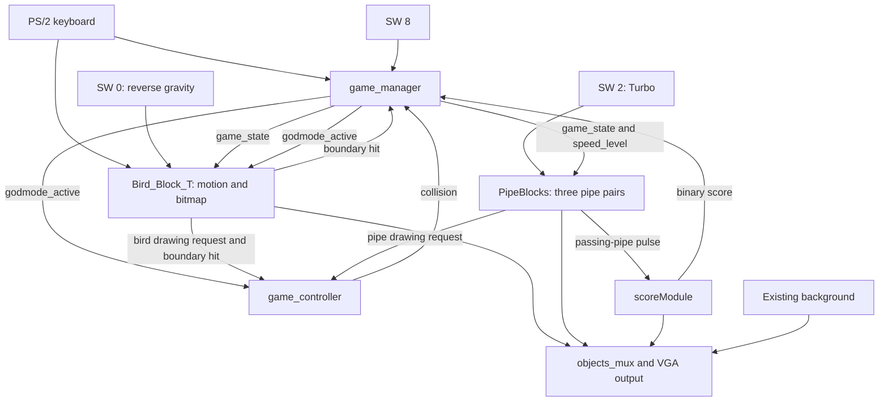

# Flappy Bird: from the MVP to the current repository

This guide explains what changed, where it changed, and how the implementation works. It covers the committed history and the local pipe-asset files present on **October 17, 2026**.

## 1. Scope and the two MVP checkpoints

The starting point is **`8ce50d4` — October 1, 2026 — `working MVP with archive`**. The current committed version is **`9a40267` — October 17, 2026 — `implement Pipes bitmaps and mifs`**. There are 12 commits after that original MVP.

There is also an archive named `lastWorkingArchive/FlappyBird_121026_MVP.qar`, added on October 12 in `b8d14e5`. If that is the MVP you mean, the later additions begin with the archive relocation in section 2.9 and the October 17 features in sections 2.10–2.12. This guide starts earlier so it includes the full development history between both checkpoints.

All file paths below are relative to **`Final_Project/`**, the directory containing this guide. Git's repository root is its parent, `ECELab1/`, so Git may print these paths with an additional `Final_Project/` prefix.

### What already existed in the original MVP

These were already implemented by `8ce50d4`:

- A VGA game with a bird sprite, background, keyboard input, and frame-based movement using fixed-point coordinates.
- A game manager with `START_SCREEN`, `PLAYING`, and `GAME_OVER` states. The bird and pipes reset on the start screen and stop on game over.
- Moving pipe pairs, random opening heights, pipe/bird collision detection, and a pulse when a pipe crosses the scoring threshold.
- A two-digit decimal score, reset for a new game, displayed around X=300 and X=320 at Y=20.
- **Four instantiated pipe pairs with 180-pixel spacing.** The `PipeBlocks.sv` module default was already three, but the top-level schematic overrode it to four.
- Existing VGA timing, clock generation, PS/2 decoding, audio, seven-segment, and other lab-support blocks. Their presence in today's tree does not make them post-MVP additions.

The original game manager itself was added in the MVP commit. The post-MVP work extends that architecture.

## 2. Changes in chronological order

### 2.1 October 5 — collision handling and red LED fix

**Commit:** `0ce1ee8` — `fix RED led with archive`.

**Where:** [game_controller.sv](ProjectFiles/FlappyBird/RTL/VGA/game_controller.sv), its `game_controller.bsf` symbol, and the then-named `RTL/VGA/TOP_VGA_DEMO.bdf`.

**What changed:** Collision detection was made specific to actual hazards, and collision feedback was reset properly for a new game.

**How:**

- Removed the score-digit drawing request from collision detection. The score display had previously been treated as a collidable object.
- Replaced overlap with the background-border drawing request with the bird movement module's explicit `bird_OOB_collision` input, connected to `bird_hit_borders`.
- Kept bird/pipe overlap as `drawing_request_bird && drawing_request_pipe`.
- Added `game_state` to the controller. Returning to `START_SCREEN` clears the collision LED latch, `SingleHitPulse`, and the per-frame collision flag.
- A valid collision now raises both `SingleHitPulse` and the LED latch. The flag limits pulse generation to once per frame; the LED remains latched until reset or the start screen.

**Why it matters:** The score no longer causes game over, boundary detection comes from movement logic, and the collision LED clears between games.

**Archive added:** `lastWorkingArchive/FlappyBird_5_10_workingREDLED.qar`.

### 2.2 October 6 — reverse gravity using SW[0]

**Commit:** `34bfe68` — `add reverse gravity mode using switch 0, with archive`.

**Where:** [bird_move.sv](ProjectFiles/FlappyBird/RTL/VGA/bird_move.sv), [birdBitMap.sv](ProjectFiles/FlappyBird/RTL/VGA/birdBitMap.sv), [Bird_Block_T.bdf](ProjectFiles/FlappyBird/RTL/VGA/Bird_Block_T.bdf), the top-level schematic, and their affected `.bsf` symbols.

**What changed:** SW[0] reverses both the bird's vertical physics and the sprite's orientation.

**How:** VGA Y increases downward. In normal mode, a flap assigns a negative velocity; gravity gradually increases that velocity. In reverse mode, a flap assigns a positive velocity and gravity gradually decreases it.

With the current constants:

```text
MAX_Y_SPEED = 500 fixed-point units
Y_ACCEL = -10
normal flap:  Yspeed = -250; frame acceleration adds 10
reverse flap: Yspeed = +250; frame acceleration subtracts 10
```

The initial kick also follows the selected gravity direction. Velocity limiting checks the appropriate sign for each mode. The bitmap module reverses its source row when the switch is high, so the bird turns upside down without storing another image.

The new switch signal is routed through `Bird_Block_T` to movement and rendering. It was originally called `reverse_gravity_switchN`; October 12 renamed it to `reverse_gravity_switch`. Despite the earlier `N` suffix, the code enables reverse mode when the signal is **high**.

The old, unused `collision` input of `bird_move` was replaced by the gravity input; game-state handling already governed death and stopping.

**Archive:** `lastWorkingArchive/FlappyBird_6_10_reverseGravitySwitch.qar`. Several older September archives were removed during this checkpoint.

### 2.3 October 7 — pause and resume with the keypad slash key

**Commit:** `9b4a6d0` — `create working pause screen with / , add archive`.

**Where:** [game_manager.sv](ProjectFiles/FlappyBird/RTL/game_manager.sv), `bird_move.sv`, [pipe_move.sv](ProjectFiles/FlappyBird/RTL/VGA/pipe_move.sv), [PipeBlocks.sv](ProjectFiles/FlappyBird/RTL/VGA/PipeBlocks.sv), the top-level schematic, and `game_manager.bsf`.

**What changed:** Added a fourth game state, `PAUSED = 2'b11`, and a `pause_key` input.

**How:**

- The existing keyboard decoder's `slash` output is wired to the manager as `slashKey`.
- The manager stores the previous key level in `pause_key_D`. Only a rising edge toggles between `PLAYING` and `PAUSED`, so holding the key does not toggle repeatedly.
- Both motion modules have a `PAUSED` branch that leaves their movement registers unchanged, preserving position, velocity, and their current motion-FSM step.
- `PipeBlocks` already passes `startOfFrame` to pipe movement only while `PLAYING`; that also prevents new frame steps while paused.
- Resuming continues the saved motion rather than resetting the game.

**Important distinction:** The commit calls this a “pause screen,” but the implementation freezes gameplay and continues rendering the scene. It does not add a separate pause image or text overlay.

This commit also added `*.json` to the repository-root `.gitignore`, which affects newly untracked JSON files. Files already tracked by Git remain tracked.

**Archive initially added:** `FlappyBird_7_10_withPauseScreen.qar`; it was replaced by the next checkpoint's archive.

### 2.4 October 7 — three pipes, a wider opening, and revised randomness

**Commit:** `dd37824` — `better random and made it to 3 pipes with pause screen using slash, with archive`.

**Where:** [random.sv](ProjectFiles/FlappyBird/RTL/KEYBOARDX/random.sv), [Pipe_Object.bdf](ProjectFiles/FlappyBird/RTL/VGA/Pipe_Object.bdf), and the top-level schematic.

**What changed:**

- The top-level `PipeBlocks` instance changed from **4 pipes / 180-pixel spacing** to **3 pipes / 240-pixel spacing**. Both configurations have a nominal 720-pixel total cycle.
- The opening between the pipe caps increased from **88 to 128 pixels**, through the `GAP_SIZE` schematic parameter.
- The random generator's feedback and range mapping changed.

**How the RNG changed:** The 16-bit shift-register feedback now XORs bits `[15]`, `[13]`, `[12]`, and `[10]`; previously it used `[1]` instead of `[12]`. The output changed from modulo mapping to:

```text
RANGE = MAX_VAL - MIN_VAL + 1
dout = MIN_VAL + ((random_state * RANGE) >> 16)
```

This scales the 16-bit state into the configured range. It is a deterministic pseudorandom generator with reset seed `16'hECE2`; resetting it repeats the underlying sequence. The master RNG continuously advances, while each pipe samples a height on first activation and on wrapping. That continuous-generator/sampled-height arrangement already existed in the MVP.

**Archive:** `lastWorkingArchive/FlappyBird_7_10_ThreePipesBetterRandom.qar`. Older four-pipe and scoring-development archives were removed.

### 2.5 October 7 — three-digit score in the upper-right corner

**Commit:** `aaaa1fa` — `made numbers only show when counting, and made it so they are in top right`.

**Where:** [scoreModule.sv](ProjectFiles/FlappyBird/RTL/VGA/scoreModule.sv), `scoreModule.bsf`, `Bird_Block_T.bdf`, and the top-level schematic. The score behavior is implemented in `scoreModule.sv`.

**What changed:**

- Added a hundreds digit, expanding the counter from 00–99 to 000–999.
- Moved the digit positions to X=560, 580, and 600, all at Y=20.
- Hid leading zeroes: `7`, `42`, and `105` are displayed instead of `007`, `042`, and `105`.

**How:** The counter stores three BCD digits. A units rollover increments tens; a tens rollover increments hundreds. Each digit has a 16×32 `square_object` and `NumbersBitMap`. The display selector enables hundreds when nonzero and tens when either tens or hundreds is nonzero. The red digit color remains `8'b11100000`.

**Important details:**

- The units digit remains visible at zero, including on the start screen. “Only show when counting” refers to suppressing leading zeroes, not hiding the complete score outside gameplay.
- After 999, the existing carry logic wraps the displayed score to 0; it does not saturate or retain a high score.
- The passing-pipe trigger and its rising-edge detection existed before this change.

### 2.6 October 10 — bird image/dimension iteration

**Commit:** `3724d9e` — `update Bird dimentions`.

**Where:** `RTL/birdPic.mif`, the top-level schematic, `images/BirdPicExtended.png`, and `images/output_BirdPicExtended_20261010_202308/`.

The bird image was regenerated, and the generated MIF, bitmap-module template, and output preview were saved alongside the source image. This was an intermediate image revision; its extended-image files were removed in the October 12 correction.

**Archive added:** `lastWorkingArchive/FlappyBird_10_10_betterBirdMIF.qar`.

### 2.7 October 12 — project top-level renamed and image/report refreshed

**Commit:** `245c9d6` — `updated to the latest`.

**Where:** [Lab1Demo.qsf](ProjectFiles/FlappyBird/Lab1Demo.qsf), the top-level BDF, `RTL/birdPic.mif`, another generated extended-bird output directory, and the final-report DOCX.

**What changed:**

- Renamed `RTL/VGA/TOP_VGA_DEMO.bdf` to **`RTL/VGA/Top_Flappy_Bird_Game.bdf`**.
- Changed Quartus `TOP_LEVEL_ENTITY` and the corresponding `BDF_FILE` assignment to that new name.
- Removed the stale `RTL/VGA/Pipes_Block_T.bdf` source assignment. The current design uses `PipeBlocks.sv`.
- Refreshed the bird image and added the intermediate `images/output_BirdPicExtended_20261010_203722/` outputs.
- Updated `פרוייקט-תבנית לדוח מסכם.docx`, the report artifact. This is separate from the FPGA source changes; the binary document update is not evidence of another gameplay feature.

The QSF also rearranged existing thermal/power and partition assignments. Those settings appear as moved lines in the diff, rather than new gameplay logic.

**Why it matters:** A Quartus build must select the renamed top-level entity and source file together. The project/revision filename is still `Lab1Demo`; renaming the top-level design did not rename the `.qpf`/`.qsf` pair.

### 2.8 October 12 — bird skew correction and pipe geometry update

**Commit:** `b8d14e5` — `fix bird skew and pipes to be bigger`.

**Where:** `birdBitMap.sv`, `bird_move.sv`, `Bird_Block_T.bdf`, `PipeBlocks.sv`, `Pipe_Object.bdf`, `Top_Flappy_Bird_Game.bdf`, the affected `.bsf` symbols, `RTL/birdPic.mif`, and `images/output_BirdPic_20261012_112459/`.

**Bird rendering:** The implementation was changed from a 64×32 source ROM to a **32×32 source ROM**, displayed at **64×64** by doubling pixels.

```text
sourceX = offsetX >> 1
normal sourceY = offsetY >> 1
reverse sourceY = 31 - (offsetY >> 1)
address = sourceY * 32 + sourceX
```

The address narrowed from 11 to 10 bits, ROM depth changed from 2048 to 1024 bytes, and the schematic drawing rectangle changed from 64×32 to 64×64. Matching the source image, row stride, ROM configuration, and display scaling is the core of this correction. Transparency still uses the bird's existing `8'h1F` color key.

The earlier generated bird-output directories and extended-image experiments were removed. The retained conversion outputs are `BirdPic.mif`, `BirdPicBitMap.SV`, and `BirdPic_out.png` under `images/output_BirdPic_20261012_112459/`. The active design reads **`ProjectFiles/FlappyBird/RTL/birdPic.mif`** through `RTL/VGA/birdBitMap.sv`; the generated module in `images/` is a reference/conversion artifact.

**Pipe geometry:**

| Setting | Original MVP | After October 7 | Current after October 12 |
| --- | ---: | ---: | ---: |
| Body width | 40 px | 40 px | 50 px |
| Cap width | 56 px | 56 px | 64 px |
| Cap height | 20 px | 20 px | 16 px |
| Opening between caps | 88 px | 128 px | 128 px |
| Body chunk height | 8 px | 8 px | 8 px |
| Ground reference | Y=448 | Y=448 | Y=448 |
| Maximum random top chunks | 35 | 35 | 32 |

The effective geometry is configured in `Pipe_Object.bdf`, which passes its parameters into `pipe_coordinate_calc` and the body rectangles. The top-level `PipeBlocks` instance was also updated to use a maximum of 32 chunks.

For a top height of `N` chunks, the current geometry gives:

```text
top body height = N * 8
top cap Y = N * 8
bottom cap Y = N * 8 + 16 + 128
bottom body Y = N * 8 + 16 + 128 + 16
bottom body chunks = (448 - bottom body Y) / 8
cap X = body X - (64 - 50) / 2 = body X - 7
```

With N=2–32, the top body spans 16–256 pixels in height, and the bottom body starts at Y=176–416. The 32-chunk maximum leaves room for the opening and bottom pipe.

**Archives added:** `lastWorkingArchive/FlappyBird_121026_MVP.qar` and `FlappyBird_121026_fixedBirdMorphing.qar`. The latter was initially placed inside the Quartus project directory.

**Critical current detail:** Rendering now uses a 64×64 rectangle, but `bird_move.sv` still declares `OBJECT_HIGHT_Y = 32` for its boundary calculations. The visual height and movement boundary height therefore differ. This guide records the source as it stands; that discrepancy was not fixed as part of writing the guide.

### 2.9 October 14 — archive moved to the archive directory

**Commit:** `716393c` — `fix where the acrhive is located for the bird`.

Moved `ProjectFiles/FlappyBird/FlappyBird_121026_fixedBirdMorphing.qar` into `lastWorkingArchive/`. Git records this as an exact rename, with no archive-content change. No RTL behavior changed.

### 2.10 October 17 — dynamic difficulty, Turbo, Godmode, and stable spacing

**Commit:** `d7a440a` — `Add dynamic pipe speed, Turbo, Godmode, and fix pipe spacing`.

This is the main gameplay extension after the October 12 checkpoint. It changes `game_manager.sv`, `scoreModule.sv`, `PipeBlocks.sv`, `pipe_move.sv`, `bird_move.sv`, `game_controller.sv`, `Bird_Block_T.bdf`, the top-level schematic, and all affected `.bsf` interfaces.

#### A. The displayed score now controls difficulty

`scoreModule` exports a new **10-bit binary `score`** calculated from its existing BCD registers:

```text
score = 100 * hundreds + 10 * tens + units
```

There is still one score counter. The binary output is another representation of the displayed value, not a second counter. The top-level schematic routes it to `game_manager`, which produces a new **4-bit `speed_level`**.

| Displayed score | Level | Normal speed, approximately px/frame | Turbo speed, approximately px/frame |
| --- | ---: | ---: | ---: |
| 0–5 | 0 | 2.00 | 4.00 |
| 6–15 | 1 | 2.59 | 5.19 |
| 16–30 | 2 | 3.19 | 6.38 |
| 31–40 | 3 | 3.80 | 7.59 |
| 41–50 | 4 | 4.39 | 8.78 |
| 51–60 | 5 | 5.00 | 10.00 |
| 61–80 | 6 | 5.59 | 11.19 |
| 81–120 | 7 | 6.19 | 12.38 |
| 121–180 | 8 | 6.80 | 13.59 |
| 181–255 | 9 | 7.39 | 14.78 |
| 256–999 | 10 | 8.00 | 16.00 |

The manager forces level zero during reset or `START_SCREEN`. The lookup is combinational; the motion module samples the requested speed at its frame-update stage.

`pipe_move` preserves the existing 1/64-pixel fixed-point representation:

```text
normal_Xspeed = 128 + floor(384 * min(speed_level, 10) / 10)
effective_Xspeed = turbo_sync ? 2 * normal_Xspeed : normal_Xspeed
pixels per frame = effective_Xspeed / 64
```

These speeds are per frame. No new clock or divider implements the difficulty change. The formula uses integer division, so intermediate levels are quantized to 1/64-pixel steps.

Because the displayed counter wraps from 999 to 0, difficulty also returns to level zero on that rollover.

#### B. Turbo on SW[2]

The top-level schematic routes **SW[2] → `turbo` → `PipeBlocks` → each `pipe_move`**. Each motion instance synchronizes the switch through two registers, `turbo_meta` and `turbo_sync`.

While enabled, Turbo doubles the current difficulty-derived pipe speed. Turning it off returns to that level's normal speed. It does not change bird gravity, score increments, or pipe dimensions. Movement remains frozen in pause/game over; the next frame update after resuming uses the requested speed.

#### C. Godmode on SW[8]

The top-level schematic routes **SW[8] → `game_manager.godmode_switch`**. The manager synchronizes the switch once and distributes **the same `godmode_active` signal** to the manager's state logic, the collision controller, and bird movement through `Bird_Block_T`.

The three parts work together:

1. `game_controller` masks its combined boundary/pipe collision output while Godmode is active.
2. `game_manager` checks Godmode before allowing a collision or boundary hit to select `GAME_OVER`.
3. `bird_move` avoids latching new boundary hits during Godmode and clears its hit latch in its active movement branch.

The bird remains clamped by the existing position-limit code. Godmode permits continued play through pipe overlap and at the motion boundaries; it does not provide unrestricted offscreen flight. Enabling it after reaching `GAME_OVER` does not transition back into play; the game-over state still requires restart.

Raw collision inputs were removed from `PipeBlocks` and `pipe_move`. Pipes now stop according to **`game_state`**, so a raw collision cannot independently stop them while the manager permits Godmode play. This is a critical part of the feature, beyond simply masking the game-over transition.

#### D. Pipe spacing is maintained by coordinates and wrap distance

Previously, pipes started at the same spawn position and were launched by cascading activation thresholds. Each wrapping pipe was then assigned a fixed spawn coordinate. That approach could lose spacing when movement overshot a threshold, particularly at higher or changing speeds.

The new approach:

- Gives pipe `i` an initial offset of `i * PIPE_SPACING`.
- Runs all three pipe motion machines together with a common frame pulse; `trigger_move` is tied high.
- Passes `WRAP_DISTANCE = NUM_PIPES * PIPE_SPACING`, currently **720 pixels**, to every instance.
- Wraps by **adding 720 pixels to the existing position**, preserving the overshoot instead of resetting to one exact spawn coordinate.
- Converts signed fixed-point X with `Xposition >>> 6`, giving consistent rounding across X=0. Signed division would truncate negative fractional coordinates toward zero.
- Clamps exported coordinates above 1023 to 1023, keeping initially distant pipes offscreen instead of overflowing the signed 11-bit interface. Internal coordinates retain their full integer value.

With the current `pipe_move` defaults, the internal starting body positions are X=648, 888, and 1128. The last is initially exported as 1023. The wrap threshold is X=-72. These calculations still use the motion module's 64/80 body/cap-width constants; rendering uses the later 50/64 geometry.

`pipe_active` no longer starts movement. It enables first height sampling and scoring when a pipe approaches X=720. Heights are also resampled on every wrap. The height is selected before the pipe becomes visible.

The score detector continues to compare previous and current positions:

```text
previous X > threshold AND current X <= threshold
```

That comparison handles steps that skip over the exact threshold. The effective threshold is **X=180**, set in the top-level schematic, even though `PipeBlocks.sv` defaults to 150. It scores when the pipe's body-left coordinate crosses that line, rather than when the entire pipe has cleared the bird.

### 2.11 October 17 — dynamic-speed archive saved

**Commit:** `d74ce01` — `add latest archive`.

Added `lastWorkingArchive/FlappyBird_171026_dynamicPipeSpeeds.qar`. This commit changes no source logic.

**Archive coverage:** It was committed before the following pipe-texture commit. Treat it as the dynamic-speed checkpoint; the history does not establish it as a backup of the final textured-pipe design.

### 2.12 October 17 — textured pipe bodies and caps

**Commit:** `9a40267` — `implement Pipes bitmaps and mifs`.

**What changed:** Replaced flat pipe colors with image-based body tiles and cap sprites, while preserving the existing opening layout, motion, and geometric drawing regions.

#### A. Body texture

**Added:** [pipeLongBitMap.sv](ProjectFiles/FlappyBird/RTL/VGA/pipeLongBitMap.sv), [pipeLong.mif](ProjectFiles/FlappyBird/RTL/pipeLong.mif), `pipeLongBitMap.bsf`, and [pipeLong.png](images/pipeLong.png).

The image is **50×8**, stored as **400 8-bit pixels**. Tall pipe bodies reuse that tile vertically:

```text
sourceX = local X
sourceY = local Y modulo 8 = offsetY[2:0]
address = sourceY * 50 + sourceX
```

[pipe_square_object.sv](ProjectFiles/FlappyBird/RTL/VGA/pipe_square_object.sv) still computes the body rectangle and its height from `numberOfChunks`. It now instantiates `pipeLongBitMap` to provide color and drawing request. Its default dimensions changed to 50-pixel width and 8-pixel chunk height. `OBJECT_COLOR` remains in the interface for schematic compatibility, but the MIF supplies the body colors.

**Critical timing detail:** The ROM receives the current combinational pixel offsets, not the already registered `offsetX`/`offsetY` outputs. The ROM's registered address and the registered drawing request both introduce one clock of latency. Feeding registered offsets into it would add another stage and misalign the body relative to the caps.

#### B. One cap ROM serves both ends of each pipe pair

**Added:** [pipeEdgeBitMap.sv](ProjectFiles/FlappyBird/RTL/VGA/pipeEdgeBitMap.sv), [pipeEdge.mif](ProjectFiles/FlappyBird/RTL/pipeEdge.mif), `pipeEdgeBitMap.bsf`, and [pipeEdge.png](images/pipeEdge.png).

The source is a **64×16 bottom-cap image**, stored as **1024 8-bit pixels**. `Pipe_Object.bdf` replaces its two cap rectangles with one bitmap module that checks whether the current VGA pixel is in the upper or lower cap.

- Bottom cap: read source row `localY`.
- Top cap: read source row `15 - localY`.
- Because Y is four bits, `~localY[3:0]` implements that reversal.
- Because the width is 64, the address is `{sourceY, localX}`, equivalent to `sourceY * 64 + localX`.

The two caps occupy different screen rows, so one ROM can supply whichever cap is being drawn at the current pixel. Both requests are registered alongside the ROM address, matching the bodies' one-clock drawing stage. There is no second upside-down MIF.

Each of the three `Pipe_Object` instances has **one cap ROM**, for **3 KiB of logical cap data**, compared with 6 KiB if each end had a separate full ROM. The two bodies in each pair each instantiate a 400-byte tile ROM, giving another 2400 bytes across three pairs. Combined logical pipe image data is **5472 bytes**, before synthesis optimizations and physical RAM-block packing; this is not a measured FPGA resource report.

#### C. Per-part RGB selection

**Added:** [pipe_color_mux.sv](ProjectFiles/FlappyBird/RTL/VGA/pipe_color_mux.sv) and `pipe_color_mux.bsf`.

`Pipe_Object.bdf` previously supplied one constant pipe color. It now routes body and cap colors through a combinational selector with priority:

```text
top cap > bottom cap > top body > bottom body
```

Both cap RGB inputs share the same ROM output. The four drawing requests are still ORed to produce `pipeDR`. The selector adds no clock stage or image storage. `PipeBlocks` then combines the three pairs' outputs, and the existing `objects_mux` combines pipes with the bird, score, and background.

#### D. Pixel format and collision behavior

All pipe pixels use **RRRGGGBB**: three red bits, three green bits, and two blue bits. Every source pixel is opaque, including dark borders. Pipe drawing requests come from geometric inclusion, rather than rejecting a particular pixel color. This differs from the bird's `8'h1F` transparency key.

The collision controller still uses overlap between bird and pipe drawing requests. The texture change does not create an alpha-based or hollow collision mask; the cap/body regions remain solid hazards.

#### E. Quartus integration and the constant helper

[Lab1Demo.qsf](ProjectFiles/FlappyBird/Lab1Demo.qsf) now explicitly includes all three new SystemVerilog modules and both pipe MIFs. `Pipe_Object.bdf`, `Pipe_Object.bsf`, and `pipe_square_object.bsf` were updated with the new blocks/interfaces.

[MyConstant.sv](ProjectFiles/FlappyBird/RTL/VGA/MyConstant.sv) also changed its parameter declaration to explicit `parameter logic [size-1:0] MyValue` and its output to `wire [size-1:0]`. It remains a constant assignment; this is a declaration/tool-compatibility change, not a new game function. The old constant-green pipe-color block is no longer the source of pipe RGB.

## 3. Current local additions outside the committed history

At the start of this review, tracked files matched `9a40267`, and these **eight untracked files** were present under `images/`:

| File | Purpose |
| --- | --- |
| [Generate-PipeLongAssets.ps1](images/Generate-PipeLongAssets.ps1) | Converts the body PNG to its MIF, BMP copy, and quantized preview. |
| [Generate-PipeEdgeAssets.ps1](images/Generate-PipeEdgeAssets.ps1) | Converts the cap PNG to its MIF, BMP copy, and quantized preview. |
| [pipeLong.md](images/pipeLong.md) | Body-tiling, timing, and regeneration notes. |
| [pipeEdge.md](images/pipeEdge.md) | Shared-cap ROM, flipping, timing, and memory notes. |
| [pipeLong.bmp](images/pipeLong.bmp) | Bitmap-format copy of the body PNG. |
| [pipeEdge.bmp](images/pipeEdge.bmp) | Bitmap-format copy of the cap PNG. |
| [pipeLong_RGB332.png](images/pipeLong_RGB332.png) | Preview of body colors after VGA quantization. |
| [pipeEdge_RGB332.png](images/pipeEdge_RGB332.png) | Preview of cap colors after VGA quantization. |

These are useful parts of the current workspace, but they are not included in the committed history through `9a40267`.

### How the asset generators work

Both scripts use PowerShell and `System.Drawing`. They accept an optional `-Source` path and otherwise read the corresponding PNG beside the script. They require the exact image dimensions and reject any pixel whose alpha is not 255.

For each pixel, they keep the high bits of the source channels:

```text
r3 = R >> 5
g3 = G >> 5
b2 = B >> 6
pixelByte = (r3 << 5) | (g3 << 2) | b2
```

They write the MIF in row-major order, save a BMP copy, and reconstruct a PNG preview from the quantized channels. The preview shows the limited FPGA color palette before a hardware build.

Run these from `Final_Project/` after editing the source images:

```powershell
powershell.exe -NoProfile -ExecutionPolicy Bypass -File images/Generate-PipeLongAssets.ps1
powershell.exe -NoProfile -ExecutionPolicy Bypass -File images/Generate-PipeEdgeAssets.ps1
```

These commands overwrite the corresponding `RTL/*.mif`, BMP, and preview files. Editing a PNG alone does not update the FPGA ROM; regenerate its MIF and rebuild the Quartus design.

## 4. How the current pieces connect



The top-level [Top_Flappy_Bird_Game.bdf](ProjectFiles/FlappyBird/RTL/VGA/Top_Flappy_Bird_Game.bdf) is the wiring authority for these connections and for instance parameter overrides. Its `CLK_31P5` output is the shared internal `clk`. Some inherited comments refer to 50 MHz or 30 Hz; this guide uses the actual wiring and describes motion in pixels per frame.

### Current controls

| Input | Behavior | Route |
| --- | --- | --- |
| Keypad 8 | Start from the start screen; flap during play | `keyIsPressed[8]` to manager and bird |
| Keypad Enter | Return from game over to the start screen | `enterKey` to `restart_key` |
| Keypad / | Pause or resume on each press | `slashKey` to `pause_key` |
| SW[0] high | Reverse gravity and vertically flip the bird | `Bird_Block_T` to movement and bitmap |
| SW[2] high | Double the current pipe speed | `PipeBlocks` to each motion instance |
| SW[8] high | Enable Godmode after synchronization | manager to collision and bird logic |

The keypad specificity comes from the existing decoder's scan codes; a main-keyboard slash or Enter is not necessarily decoded as the same key.

### Current state behavior

| State | Encoding | Behavior |
| --- | --- | --- |
| `START_SCREEN` | `00` | Reset bird and pipe positions, score, and collision feedback; speed level zero. Keypad 8 starts play. |
| `PLAYING` | `01` | Update movement on frame pulses, score passing pipes, apply speed level and switch modes. Unguarded collision/boundary hit selects game over. |
| `GAME_OVER` | `10` | Stop motion and retain the last score/scene. Enter returns to the start screen. |
| `PAUSED` | `11` | Hold movement state and render the frozen scene. A new slash press resumes. |

Outside Godmode, collision has priority over a simultaneous pause request in the manager's `PLAYING` branch. Neither “start screen” nor “game-over screen” by itself implies a separate image: those state names predate the post-MVP work.

## 5. File map: where to look when changing something

| Concern | Main implementation | Integration or supporting files |
| --- | --- | --- |
| State transitions, pause, score-to-level table, shared Godmode synchronization | `ProjectFiles/FlappyBird/RTL/game_manager.sv` | `game_manager.bsf`, top-level BDF |
| Bird physics, flap direction, boundary latch and clamping | `RTL/VGA/bird_move.sv` | `bird_move.bsf`, `Bird_Block_T.bdf` |
| Bird scaling, reverse-image addressing, transparency | `RTL/VGA/birdBitMap.sv`, `RTL/birdPic.mif` | `birdBitMap.bsf`, `Bird_Block_T.bdf`, generated bird assets under `images/` |
| Pipe count, first height sampling, RNG use, passing-pipe scoring | `RTL/VGA/PipeBlocks.sv` | `PipeBlocks.bsf`, top-level instance parameters |
| Speed, Turbo synchronization, initial offsets, wrapping | `RTL/VGA/pipe_move.sv` | Instantiated by `PipeBlocks.sv`; `pipe_move.bsf` also updated |
| Random sequence and range mapping | `RTL/KEYBOARDX/random.sv` | Master RNG instance inside `PipeBlocks.sv` |
| Pipe geometry and part assembly | `RTL/VGA/Pipe_Object.bdf` | `pipe_coordinate_calc.sv`, `Pipe_Object.bsf` |
| Body rectangle and repeating texture | `RTL/VGA/pipe_square_object.sv`, `pipeLongBitMap.sv` | `RTL/pipeLong.mif`, `images/pipeLong.png` |
| Shared upper/lower cap texture | `RTL/VGA/pipeEdgeBitMap.sv` | `RTL/pipeEdge.mif`, `images/pipeEdge.png`, `Pipe_Object.bdf` |
| Body/cap color choice | `RTL/VGA/pipe_color_mux.sv` | `pipe_color_mux.bsf`, `Pipe_Object.bdf` |
| Collision output, pulse, collision LED latch | `RTL/VGA/game_controller.sv` | `game_controller.bsf`, top-level BDF |
| Decimal score, leading-zero suppression, binary score output | `RTL/VGA/scoreModule.sv` | Existing `NumbersBitMap.sv`/`numbers.mif`, `scoreModule.bsf` |
| Project sources and selected top level | `ProjectFiles/FlappyBird/Lab1Demo.qsf` | `Lab1Demo.qpf`, `RTL/VGA/Top_Flappy_Bird_Game.bdf` |
| Asset regeneration | `images/Generate-PipeLongAssets.ps1`, `Generate-PipeEdgeAssets.ps1` | The two asset Markdown notes, BMPs, and RGB332 previews |
| Saved Quartus checkpoints | `lastWorkingArchive/*.qar` | Checkpoint dates/features described above |

In this table, paths beginning `RTL/` and standalone `.bsf` filenames are relative to `ProjectFiles/FlappyBird/`.

`.sv` files implement logic. `.bdf` files instantiate blocks, connect nets, and override parameters. `.bsf` files describe schematic symbols and their ports/parameters. `.mif` files initialize ROM contents. A new RTL port needs matching symbol and schematic wiring wherever that interface is instantiated; changing only the SystemVerilog is insufficient for this design.

## 6. Critical implementation details to retain

1. **Check instance overrides before trusting module defaults.** Current rendering uses a 50-pixel body, 64×16 caps, and a 128-pixel opening. The coordinate calculator's standalone defaults still say 64/80/20/88. The effective scoring threshold is 180, while the `PipeBlocks` default is 150. The original MVP's four pipes were also a top-level override.
2. **Keep source dimensions, ROM depth, addressing, and drawing rectangles consistent.** That agreement is central to the bird correction and the new pipe textures. Cap and tile widths are currently embedded in their bitmap modules.
3. **Preserve pixel timing when changing pipe rendering.** Body and cap colors/requests describe the same pixel one clock after sampling. The per-part color mux is combinational. Adding a register to one path changes that alignment.
4. **Let the game manager decide when play ends.** Removing direct collision stopping from pipe motion was needed for Godmode. Share the synchronized `godmode_active` signal among its users.
5. **Preserve wrap overshoot and initial offsets.** Adding the full cycle length to position, rather than assigning a fixed spawn point, maintains spacing across variable speeds and Turbo.
6. **Pause preserves motion state rather than restarting it.** Its key uses rising-edge detection. The score counter itself has no explicit `PAUSED` guard; the ordinary score source stops crossing thresholds when pipe positions stop.
7. **The bird boundary height still differs from its rendered height.** The movement module uses 32 pixels, while the rendering rectangle is 64×64. Also, the Godmode comment says its boundary latch is cleared “including while paused,” but the clearing statement is after the `PAUSED` branch and therefore does not execute during pause. These are source observations to consider in future validation, not corrections included here.
8. **Score wraps, and difficulty follows it.** After 999, the counter returns to 0 and the manager selects speed level zero. There is no persistent high-score feature in these changes.
9. **Use the active MIF paths.** FPGA ROMs load files under `ProjectFiles/FlappyBird/RTL/`; PNGs and generated reference modules under `images/` are not automatically synthesized.
10. **A saved archive is a checkpoint.** The latest committed `.qar` precedes the pipe-texture commit. There is no later texture-specific archive added in this history.

## 7. Evidence and verification for this guide

This guide was checked against the ordered commit history, the diff from `8ce50d4` to `9a40267`, the current SystemVerilog, Quartus source assignments, and the parameters/connections in the current and MVP BDFs. Dates above are commit dates.

Both pipe source PNGs were compared pixel by pixel with their active MIFs using the generators' RRRGGGBB conversion: **400 body pixels and 1024 cap pixels matched, with no mismatches and fully opaque source pixels**.

The IDE context mentioned `ProjectFiles/FlappyBird/tests/pipe_texture_tb.sv` and `run_pipe_texture.do`. Those files are **absent from the current disk tree and from this checkout's commit history for that tests directory**, so this guide does not describe them as delivered tests or claim they passed.

This was a documentation/source-history review. No Quartus compilation, ModelSim simulation, FPGA resource measurement, or hardware gameplay test was run for it. Archive contents were not restored to establish equivalence with the current working tree.

To inspect a checkpoint yourself from this directory:

```powershell
git log --reverse --oneline 8ce50d4..9a40267
git show d7a440a -- ProjectFiles/FlappyBird/RTL/VGA/pipe_move.sv
git diff 8ce50d4 9a40267 -- ProjectFiles/FlappyBird
git status --short
```
